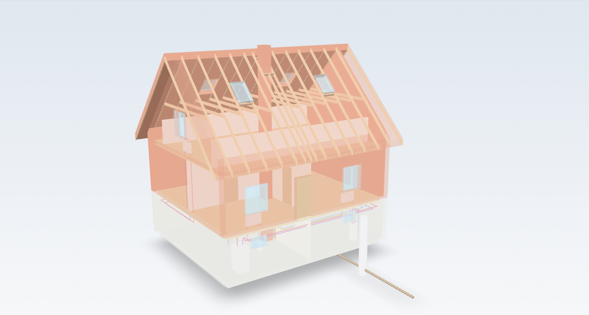
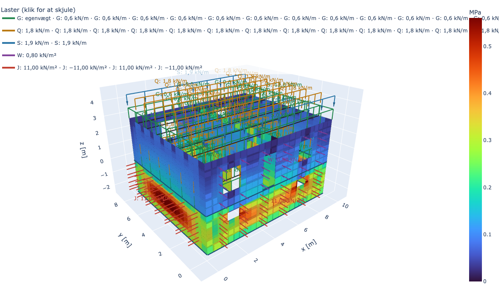
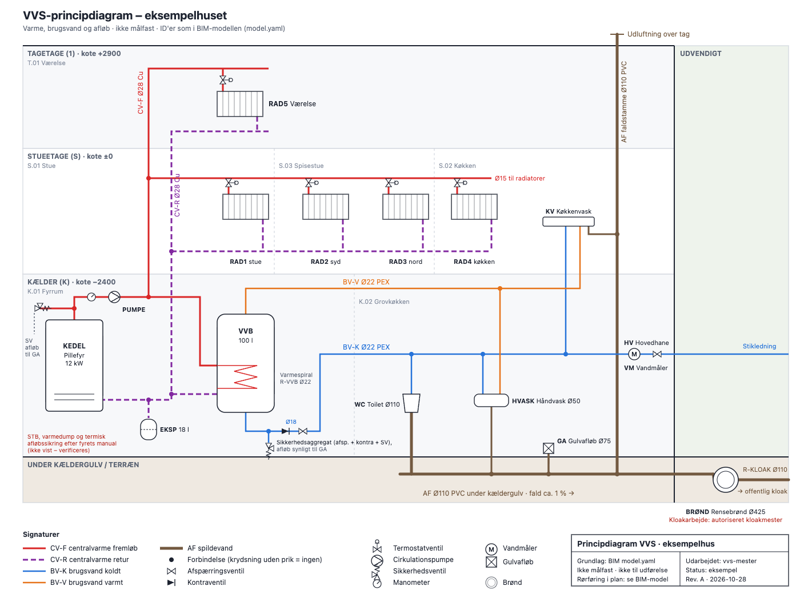

# (Over) Engineer Any House

For de fleste er det her overengineering. Det er til dig, der bygger en digital tvilling af dit hus og gerne går hele vejen ned i kaninhullet – BIM-model, FEM-beregning og et fagnotat pr. fag til et projekt, en håndværker ville løse med en blyant. Risikoen er reel: det er let at gøre en simpel opgave alt for kompliceret. Spørg derfor altid dig selv (og projektlederen), om dybden står mål med opgaven.

*[Dansk](README.da.md)*

A team of building-expert agents for [Claude Code](https://claude.com/claude-code) and Claude Cowork that helps you understand, plan and renovate an existing house.

Most houses come with little more than a few old drawings, a public building record and whatever you can see. Engineer Any House works out the rest. It decodes old drawings into a BIM model, looks up property data and plans, and has a team of specialists assess the house and the work you want done. Every answer is checked by an independent reviewer before you see it.

> **Danish edition.** The current knowledge bases, regulations and the agents' language are Danish (BR18, DS standards, Eurocodes with Danish annexes, Danish public data). The architecture is country-neutral, and other countries can be added as their own editions. See [Contributing](#contributing).

> The agents advise and plan. They do not replace licensed tradespeople, certified engineers, mandatory inspections or the building authority. Knowledge marked **T** must be verified before it is used as a requirement.

## How it works

- **A project lead** interviews you, sets up a case folder, plans the work in phases with gates, and coordinates the specialists.
- **Specialist agents at master level**, one per trade: plumbing and heating, electrical, masonry, ventilation, painting, carpentry, structural engineering, architecture, landscaping and BIM. Each has its own knowledge base with sources, checklists and lessons learned.
- **Independent quality control** with one reviewer agent per trade. The reviewer has its own knowledge, read-only tools and no access to the specialist's reasoning. It approves or rejects each deliverable with sourced findings. Rejected work goes back with the findings. Repeated rejection escalates to you and triggers a root-cause analysis, and the lesson is built into the specialist.
- **Hooks enforce the loop**, so it doesn't depend on the agents following instructions. A deliverable cannot be skipped, reviewed by the wrong reviewer or changed after approval, and a session cannot end with unreviewed work.
- **BIM from old drawings.** Scanned drawings are decoded, modelled in IFC4 with IfcOpenShell and compared view by view against the original by a separate agent until they match.
- **Structural calculations** run in deterministic tools (a FEM model with PyNite and hand checks), not in the language model. Results are always labelled as estimates.

## See it in 3D

One example house from the repository, built and computed by the tools in CI. The BIM model has roof windows and the full plumbing and heating installation (central heating, radiators, hot water tank, hot and cold water, drains), with two facades and one roof face see-through. The FEM model is the same house's walls and slabs. Click a picture to open the interactive viewer.

| BIM model (IFC4) | FEM model (walls and slabs as shells) |
|---|---|
| [](https://savnik.github.io/engineer-any-house/bim/) | [](https://savnik.github.io/engineer-any-house/fem/) |
| Built with `bim.py build`, exported to glTF with `bim.py export` | Computed with `fem.py calc`, shown with `fem.py view`: pick a load combination and a result |

The VVS agent draws the same house's plumbing and heating as a schematic ([SVG source](plugins/byg-plumbing/skills/plumbing-knowledge/assets/schematic-example-house.svg), method in [schematic.md](plugins/byg-plumbing/skills/plumbing-knowledge/references/schematic.md)). Click to open it full size.

[](https://savnik.github.io/engineer-any-house/plumbing/schematic.svg)

## Plugins

| Plugin | Contents |
|---|---|
| `byg-team` | Meta plugin that installs everything below |
| `byg` | Project lead (skill and agent), `/byg:…` commands, case folders and knowledge bank |
| `byg-review` | Reviewer agents for every trade and the project lead, plus the hooks that enforce the review loop |
| `byg-data` | Property lookup from an address: building record, cadastre, local plan, listing status, soil contamination, groundwater, climate, energy label and valuation |
| `byg-plumbing` · `byg-electrical` · `byg-masonry` · `byg-ventilation` · `byg-painting` · `byg-carpentry` | Plumbing and heating, electrical, masonry, ventilation, painting and carpentry specialists |
| `byg-structural` | Structural engineer with FEM and load calculation tools |
| `byg-architecture` | Architect: layout, extensions, dormers, facades and planning-permission screening |
| `byg-landscape` | Landscaper: paving, terraces, rainwater, drainage, grading, fences and trees |
| `byg-bim` | BIM modeller, drawing comparer and the `bim.py` tool (IFC4, drawings, sections, 3D, drawing import) |

The trade plugins depend on `byg-review`, so quality control is always installed with them.

## Installation

Requires Claude Code and `python3` on your PATH (the hooks are written in Python).

```
claude plugin marketplace add savnik/engineer-any-house
claude plugin install byg-team@engineer-any-house
```

Or from a local clone: `claude plugin marketplace add ./engineer-any-house`. Restart the session after installing.

**Claude Cowork:** build the combined package with `python3 scripts/package.py` and upload `dist/cowork/byg.plugin`. Install either the marketplace or the combined package, not both.

## Usage

| Command | Purpose |
|---|---|
| `/byg:new-project <description>` | Start a project: interview → case folder → reviewed project brief → plan |
| `/byg:coordinate [case]` | Ask the specialists, review their answers and combine them into a plan |
| `/byg:status [case]` | Phase, next steps, open questions and review status |
| `/byg:ask <trade> <question>` | Quick question to one specialist, with a reviewed answer |
| `/byg:lessons [case]` | Harvest lessons from a finished case into the knowledge bank |
| `/byg:new-trade <trade-id>` | Add a new trade with its own reviewer |

You can also run the project lead as the main agent: `claude --agent byg:project-manager`. You write in Danish, and the agents answer in Danish.

Cases are stored in `byg-cases/<YYYY-MM-DD>-<name>/` in your working directory. Keep sessions short and continue a case in a new session with `/byg:status <case-id>`, since the case folder remembers the rest.

## Data and privacy

Cases and your data stay on your machine: case folders in your working directory, the knowledge bank and review state in the plugin's data folder, and API keys in `~/.config/`. None of it goes into the plugins or this repository. Lessons from cases only reach the repository as generalised knowledge, and `scripts/check_data.py` blocks commits that contain case data, private terms or keys.

## Measured, not assumed

Specialists are measured with exams built from the official learning objectives for the trade, so far for electrical, plumbing and heating, ventilation and structural engineering. Each exam has a held-out set that the improvement agent cannot read. Changes to a knowledge base or prompt are run against the exam with and without the plugin and kept only if they measurably help. See `exam/README.md` (Danish).

## Contributing

Contributions are welcome, especially:

- **New countries.** The protocols, review loop, hooks, BIM tools and exam framework are country-neutral. A new edition needs its own knowledge bases, reviewer knowledge and exams based on that country's regulations.
- **New trades** via `/byg:new-trade` or `python3 scripts/new_trade.py`.
- **Corrections** to the knowledge bases, with a source.

The developer documentation is in Danish: the development section of [README.da.md](README.da.md#udvikling) and [ARCHITECTURE.md](ARCHITECTURE.md). In short, run `python3 scripts/sync_protocol.py && python3 scripts/validate.py` after changes, and put a version note in `release-notes/` instead of raising versions on a branch. Everyone is welcome to open issues and pull requests. `main` is protected: every change goes through a pull request, CI (structure validation, ruff, BIM tests and the FEM self-test) must pass, and only maintainers with write access can merge.

## License

[MIT](LICENSE)
